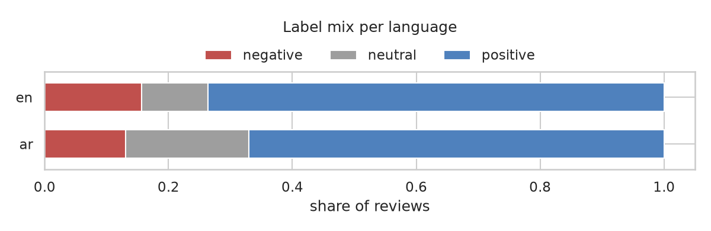
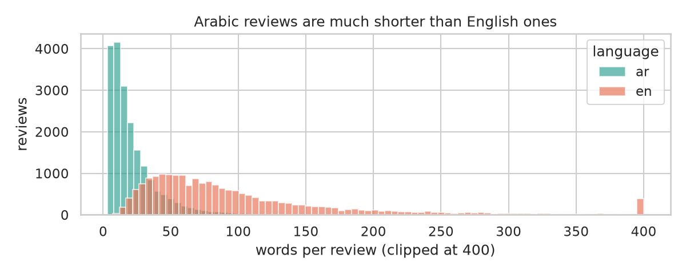
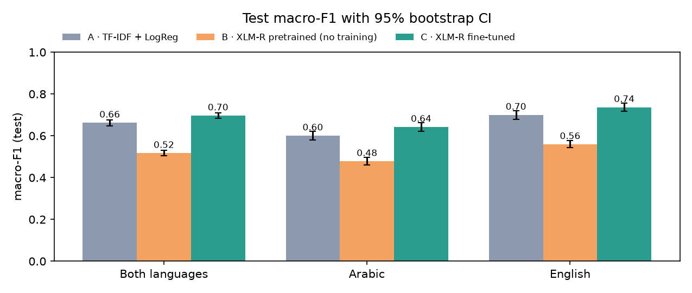
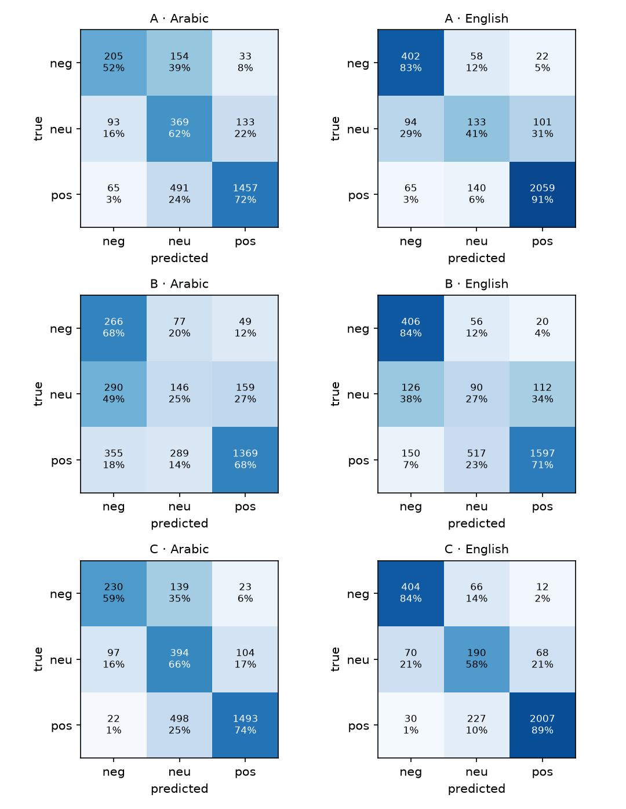

# Arabic/English Sentiment Classifier

> UneeQ Interns · Machine Learning Track · October 2026
> **Demo video:** [YouTube/LinkedIn link](#) · **Author:** Michael Danial

A hotel group gets customer feedback in Arabic and English. This project sorts each review into **negative,
neutral or positive** so the support team can see complaints first. It compares three approaches on exactly the
same test reviews: a classical TF-IDF baseline, a pretrained multilingual transformer used as is, and the same
transformer fine-tuned on our data.

**Headline result (untouched test split, 6,074 reviews: 3,000 Arabic, 3,074 English):**

| Approach | Macro-F1, both languages (95% CI) | Arabic | English | Neutral F1 | Size · speed |
|---|---|---|---|---|---|
| **A** · TF-IDF + Logistic Regression | 0.663 (0.648–0.677) | 0.601 | 0.700 | 0.44 | 13 MB · 0.8 ms/review on a CPU |
| **B** · XLM-R sentiment model, no training | 0.517 (0.504–0.530) | 0.478 | 0.560 | 0.23 | 1.1 GB · 2.3 ms/review on a T4 GPU |
| **C** · XLM-R fine-tuned on our data | **0.697** (0.684–0.710) | **0.642** | **0.737** | **0.48** | 1.1 GB · 1.9 ms/review on a T4 GPU |

- **C is the best model, but only by 0.034 macro-F1 over the baseline** (paired bootstrap 95% CI +0.020 to +0.048).
  It wins in both languages. A 13 MB linear model gets about 95% of the way there.
- **Using a pretrained sentiment model as is was the worst option by far** (−0.15 vs the baseline). It was trained on
  tweets, and hotel reviews in Booking.com's "liked / disliked" format confuse it.
- **Neutral is the hard class for every model** (F1 ≤ 0.48). Most errors are one step off (positive ↔ neutral).
- **A confidence threshold makes C usable in practice:** it handles **72%** of reviews alone at **90%** accuracy
  and sends the rest to a person.

> **Read this first:** labels come from **star ratings**, not from people reading the text. In a random audit of 50
> errors from model C, **12 (24%) had a star rating that contradicts or doesn't match the text**. Part of the "error" is
> label noise, so the true quality is somewhat higher than these numbers, and no model can reach 1.0 on this data.

## 1. Business problem
Support teams read feedback to find unhappy customers quickly. Manually triaging thousands of reviews in two
languages is slow. The model's job is to **sort and prioritise** reviews: negative ones go to the front of the queue,
low-confidence predictions go to a person. It is a decision aid, not an automatic judgement on a customer.

The task asks for a fair comparison of at least two approaches. "Fair" here means: same data, same split, same test
rows, same metric, same evaluation code, and hyperparameters chosen on validation only.

## 2. Data
| | Arabic | English |
|---|---|---|
| **Source** | [HARD](https://github.com/elnagara/HARD-Arabic-Dataset) (Elnagar et al., 2018): Booking.com hotel reviews, 2016 | [TripAdvisor hotel reviews](https://github.com/YashSDholam/Tripadvisor-Hotel-Review-Sentiment-Analysis-using-LSTM-Neural-Network) (Alam et al., 20k version) |
| **Raw size** | 409,562 reviews, 1–5 stars | 20,491 reviews, 1–5 stars |
| **Used** | stratified sample of **20,000** | all **20,491** |
| **Text** | Modern Standard + Gulf/Egyptian dialects; median **15 words** | lower-cased, mostly punctuation- and stop-word-free; median **77 words** |

**Labels:** 1–2 stars → negative, 3 → neutral, 4–5 → positive. It is the same rule for both languages, because both
are hotel reviews on a 1–5 scale. Mix: about 70% positive in both languages; neutral is 20% of Arabic and 11% of English.

**Split:** 70 / 15 / 15 (train / val / test), stratified by **language × label**, `seed=42`. Duplicate texts
were removed before splitting, so the same review can't sit in train and test.

**How to get it:** `python -m src.data` expects the two raw files in `data/raw/` (see *How to run*). Data is gitignored.

### What the EDA showed (`notebooks/01_eda.ipynb`)
1. **Label leakage in the Arabic data.** When a guest leaves no title, Booking.com fills it with a score word:
   *استثنائي* ("exceptional") on every 5-star review, *مرضي* ("satisfactory") on every 3-star one, and so on.
   **44% of Arabic reviews start with one of 11 such words, and each word maps to exactly one rating.** A model would learn
   "word → label" and look close to perfect on half the data while learning nothing about sentiment.
   `strip_booking_score_title()` removes the word. User-written titles in “…” quotes are kept, because those are
   the guest's own words.
   
2. **Booking's form mixes praise and complaints.** Guests fill a "liked" box and a "disliked" box, so most Arabic
   reviews contain both, even 5-star ones. This is the main source of positive ↔ neutral confusion.
3. **Arabic reviews are short** (median 15 words vs 77). There is less signal per review.
   
4. **Spelling varies a lot** (أ/ا/إ, ة/ه, ى/ي, letter elongation). This is normalised for TF-IDF only; the
   transformers get the original text because their tokenizer was trained on it.

## 3. Approach
```
HARD (ar) + TripAdvisor (en) ─► strip Booking score word ─► stars → 3 labels ─► dedupe
   ─► one split, stratified by language × label (train 28k │ val 6k │ test 6k)
   ─► A: TF-IDF word 1–2 + char 2–5 n-grams → LogReg      (6 configs searched, picked on val macro-F1)
   ─► B: cardiffnlp/twitter-xlm-roberta-base-sentiment      (used as is, no training)
   ─► C: same checkpoint fine-tuned, class-weighted loss    (best of 3 epochs on val macro-F1, Colab T4)
   ─► one evaluation script, test scored once ─► bootstrap CIs, confusion matrices, errors, triage threshold
```

**Why these three.** A is the strong, cheap baseline a company would try first. B answers "can we skip training
altogether?". C answers "is a transformer worth the cost once trained on our data?". B and C share the same
checkpoint, so the gap between them is purely the effect of our training data.

**Choices that matter:**
- **Metric: macro-F1**, not accuracy. With 70% positive, a model that always says "positive" scores 70% accuracy and is useless.
- **One model for both languages** in every approach, so no approach gets a per-language advantage.
- **Class weighting** (`balanced`) won on val for A (+0.04 macro-F1). C uses the same weighting in its loss.
- **Character n-grams** in A handle Arabic prefixes and suffixes (ال، و، ـها) and dialect spellings without a stemmer.
- **Fairness check on the Colab run.** `notebooks/02_transformers_colab.ipynb` rebuilds the dataset in Colab from
  the public sources with this repo's own `src/` code. It then checks the file's **SHA-256 against the local build**
  before training, so B and C saw byte-for-byte the same split as A.

Hyperparameter search for A (val macro-F1, `reports/tfidf_search.csv`): best `C=0.5`, `class_weight=balanced` (0.677).
Fine-tuning C (`reports/predictions/finetuned_xlmr_training_log.json`): val macro-F1 0.614 → 0.716 → **0.719** over
3 epochs; 15 minutes on a T4.

## 4. Results


| Test macro-F1 | Both | Arabic | English | Accuracy | F1 neg | F1 neu | F1 pos |
|---|---|---|---|---|---|---|---|
| A · TF-IDF + LogReg | 0.663 | 0.601 | 0.700 | 0.761 | 0.675 | 0.443 | 0.870 |
| B · XLM-R, no training | 0.517 | 0.478 | 0.560 | 0.638 | 0.545 | 0.225 | 0.782 |
| C · XLM-R fine-tuned | **0.697** | **0.642** | **0.737** | **0.777** | **0.734** | **0.479** | **0.877** |

**Are the gaps real?** Paired bootstrap over the test reviews (2,000 resamples, `reports/pairwise_differences.csv`):

| Comparison | Both | Arabic | English |
|---|---|---|---|
| C − A | **+0.034** (+0.020 to +0.048) | +0.041 (+0.021 to +0.061) | +0.037 (+0.013 to +0.059) |
| C − B | +0.179 (+0.163 to +0.195) | +0.164 | +0.177 |
| B − A | −0.145 (−0.162 to −0.128) | −0.123 | −0.141 |

Every interval excludes zero. C beats A in 100% of bootstrap resamples, but the margin is small.

**Where they go wrong** (rows = true label, columns = predicted):


- **Arabic positive → neutral is the biggest error for A and C** (about 25% of Arabic positives). These are 4–5 star
  reviews whose "disliked" box has a real complaint.
- **B calls 18% of Arabic positives negative.** A tweet-trained model reads the complaint half of a Booking review as the whole message.
- **Neg ↔ pos flips are rare for C** (1–6%). It mostly confuses neighbouring classes.

**Cost** (`reports/cost.csv`):

| | A | C |
|---|---|---|
| Model size | 13 MB | 1.1 GB |
| Training | ≈1 min per config on a laptop CPU | 15 min on a T4 GPU |
| Inference | 0.8 ms/review, CPU | 1.9 ms/review on a T4 GPU (much slower on CPU) |

## 5. Using it in practice: confidence triage
A support team doesn't need every review auto-labelled. It needs the easy ones done and the hard ones flagged.
On **val**, I picked the lowest confidence threshold at which the auto-handled reviews reach **90% accuracy**, then applied
it once to test (`reports/confidence_triage.csv`):

| Model | Threshold | Auto-handled (test) | Accuracy on those | Sent to a person |
|---|---|---|---|---|
| A · TF-IDF | 0.63 | 61% (Arabic 52%, English 71%) | 89.8% | 39% |
| **C · fine-tuned** | 0.80 | **72%** (Arabic 61%, English 82%) | **89.6%** | 28% |
| B · no training | n/a | never reaches 90% on val | n/a | everything |

The demo uses these thresholds (`reports/triage_thresholds.json`) to flag low-confidence predictions.

## 6. Error analysis (`src/error_analysis.py`, `reports/error_audit_sample.csv`)
**What A relies on** (`reports/tfidf_top_features.csv`). Negative: *not, no, dirty, سيء, terrible, غير, rude, worst,
not recommend*. Neutral: *ok, nothing special, average, not bad, fine, بعض الموظفين* ("some staff"). Positive: *great, loved,
رائع, جيد جدا, perfect, excellent, مريحة, جميل*. The weights make sense; neutral relies on hedges.

**Manual audit:** I read 50 random test errors from model C (25 Arabic, 25 English) and labelled why each one went wrong:

| Why C was wrong | Arabic | English | Share |
|---|---|---|---|
| **Adjacent class on a mixed review** (pos ↔ neu, neg ↔ neu) | 15 | 20 | 70% |
| **Star rating contradicts the text** (label noise) | 7 | 1 | 16% |
| **Label debatable**: text leans towards the predicted class | 1 | 3 | 8% |
| **Polarity flip** (neg ↔ pos) | 2 | 1 | 6% |

Examples (translated where Arabic):
| True → predicted (C) | Review | Why |
|---|---|---|
| neutral → negative (0.99) | "Extremely bad. Nothing [liked]. Small lobby, corridors smell awful… I don't recommend staying here." | Label noise: 3 stars, clearly negative text |
| negative → positive (0.99) | "Wonderful, and I'll come back, God willing. Everything was beautiful… weak lighting in the lounge." | Label noise: 1–2 stars, positive text |
| positive → neutral (0.86) | "Good. Cleanliness. Rooms very cramped." | Booking two-box review; one point each way |
| positive → neutral (0.82) | "pleasant stayed nights recently business, got good impression hotel breakfast…" | Mild praise; neutral and positive overlap |
| negative → positive (0.74) | "soooo wanted love hotel did n't…" | Contrast ("wanted to love it, didn't") missed |
| negative → neutral (0.62) | "Power cuts for long hours over two days" | Very short Arabic fragment, no explicit sentiment word |

**Other patterns:**
- **11% of test reviews (676) are wrong for all three models**: 16% of Arabic, 6% of English (`reports/agreement.csv`).
  Most are this label-noise and mixed-review kind.
- **Length:** the shortest Arabic reviews (0–7 words) are the hardest (C: 0.56). Long English reviews (150+ words) drop
  for every model, and B collapses there (0.39) (`reports/figures/f1_by_length.png`).
- **Truncation:** transformers read at most 256 tokens. That cuts **14% of English reviews** (0.3% of Arabic), and
  part of the long-review drop comes from that.

## 7. Limitations
- **Labels are star ratings, not human judgements of the text.** About a quarter of audited errors are label noise.
  A human-labelled test sample would give a more honest ceiling.
- **One domain.** Both datasets are hotel reviews. Results won't transfer as-is to, say, telecom complaints or app reviews.
- **The two languages differ in more than language.** Arabic comes from Booking (short, two-box form, dialects);
  English from TripAdvisor (long, pre-processed). Some of the Arabic/English gap is about the source, not the language.
- **The English text arrives pre-processed** (lower-cased, many stop words removed). That suits TF-IDF and hurts
  transformers trained on natural sentences, so it probably *understates* C and especially B on English.
- **Small tuning budgets.** A got 6 configs and C got 3 epochs with one learning rate. Neither is exhaustively tuned;
  the comparison is fair in budget, not optimal for either.
- **Sentiment is per review, not per aspect.** "Great location, dirty room" is genuinely both. Aspect-based sentiment
  (room / staff / location / price) would fit this data better than three classes.
- **Old data:** 2016 (Arabic); the English reviews are older still (many mention 2007–2008). Language and expectations drift.

## 8. Demo app
```bash
streamlit run app.py        # opens http://localhost:8501
```
A five-page Streamlit app that walks through the whole project, built to be the walkthrough video instead of a
screen recording of code.

**30-second silent walkthrough:** [`demo/sentiment_demo.mp4`](demo/sentiment_demo.mp4), a real recording of this app
(scripted with Playwright on a virtual display by `demo/record.py`, edited by `demo/build.py`).


| Page | What it shows |
|---|---|
| **Try it** | Type or paste a review in Arabic or English (or pick an example). The baseline labels it live with a probability strip and a "send to a person" flag. *Pull a random test review* also shows what all three models said about that exact review, next to its star rating. |
| **Results** | Macro-F1 with 95% bootstrap intervals per language, per-class F1, an interactive confusion matrix, a **triage simulator** (move the confidence threshold, see how many reviews are handled automatically and how accurately), and cost. |
| **Mistakes** | The 50-error audit, six annotated examples (translated), and a filterable browser of every test mistake with all three models' answers. |
| **The data** | The Booking.com leakage words, label mix, review lengths and sources. |
| **Batch** | Paste many reviews or upload a CSV with a `text` column: negatives first, low-confidence ones flagged, download as CSV. |

The **live transformer** is optional (toggle on *Try it*): `pip install -r requirements-transformer.txt`. It uses
`models/xlmr_finetuned/` if you copy in the folder the Colab run saved to Google Drive
(`MyDrive/uneeq_sentiment/xlmr_finetuned`); otherwise it downloads the public pretrained checkpoint (approach B).
Everything else runs on the stored predictions, so no GPU or torch is needed for the demo.

CLI:
```bash
python -m src.predict "الغرفة نظيفة لكن الإفطار سيء" "great location, rude staff"
python -m src.predict --model transformer "hotel was ok, nothing special"
python -m src.predict --file reviews.txt > predictions.csv
```

## 9. How to run
```bash
# 1. Environment (Python 3.12)
uv venv -p 3.12 .venv && source .venv/bin/activate
uv pip install -r requirements.txt

# 2. Data → data/raw/
git clone --depth 1 https://github.com/elnagara/HARD-Arabic-Dataset.git /tmp/hard
unar -o /tmp/hard/data /tmp/hard/data/unbalanced-reviews.rar         # or: unrar x  (brew install unar)
cp /tmp/hard/data/unbalanced-reviews.txt data/raw/hard_unbalanced_reviews.txt
curl -L -o data/raw/tripadvisor_hotel_reviews.csv \
  https://raw.githubusercontent.com/YashSDholam/Tripadvisor-Hotel-Review-Sentiment-Analysis-using-LSTM-Neural-Network/main/tripadvisor_hotel_reviews.csv

# 3. Pipeline
python -m src.data               # clean, label, split  (~20 s)
python -m src.train_classical    # approach A + val search (~13 min on a laptop)
# approaches B + C: open notebooks/02_transformers_colab.ipynb in Colab (T4), Run all,
#                   unzip transformer_outputs.zip into reports/predictions/  (already included in this repo)
python -m src.evaluate           # metrics, CIs, confusion matrices
python -m src.error_analysis     # errors, length, agreement, triage thresholds
pytest -q                        # 24 tests (pipeline + app smoke tests)
```

## 10. Repository layout
```
src/
  config.py            paths, label map, Booking score words
  clean.py             score-word stripping, Arabic normalisation, language detection
  data.py              build dataset + stratified split
  train_classical.py   approach A + val search
  evaluate.py          shared scoring: macro-F1, bootstrap CIs, pairwise tests, cost, figures
  error_analysis.py    error examples, length buckets, agreement, triage thresholds, TF-IDF features
  predict.py           CLI / library inference for A and the transformer
notebooks/
  01_eda.ipynb                 EDA incl. the leakage finding
  02_transformers_colab.ipynb  approaches B + C as executed on Colab (outputs included)
  make_*_notebook.py           code that generates the notebooks
reports/               metrics, CIs, triage, audit sample, figures, predictions of all three models
tests/                 cleaning, split integrity, leakage, prediction coverage, app pages render
app.py                 Streamlit app entry (navigation)
app_pages/             the five app pages
app_lib/ui.py          app design tokens, CSS, shared components and cached data loading
.streamlit/config.toml app theme
```

## Citation
Elnagar A., Khalifa Y.S., Einea A. (2018). *Hotel Arabic-Reviews Dataset Construction for Sentiment Analysis
Applications.* In: Intelligent Natural Language Processing: Trends and Applications, Springer, pp. 35–52.
Barbieri F., Espinosa Anke L., Camacho-Collados J. (2022). *XLM-T: Multilingual Language Models in Twitter for
Sentiment Analysis and Beyond.* LREC 2022 (the `cardiffnlp/twitter-xlm-roberta-base-sentiment` checkpoint).
Alam M.H., Ryu W.-J., Lee S. (2016). *Joint multi-grain topic sentiment: modeling semantic aspects for online reviews.*
Information Sciences 339 (TripAdvisor hotel reviews).
